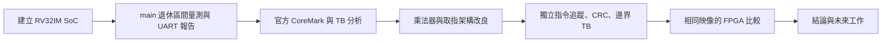
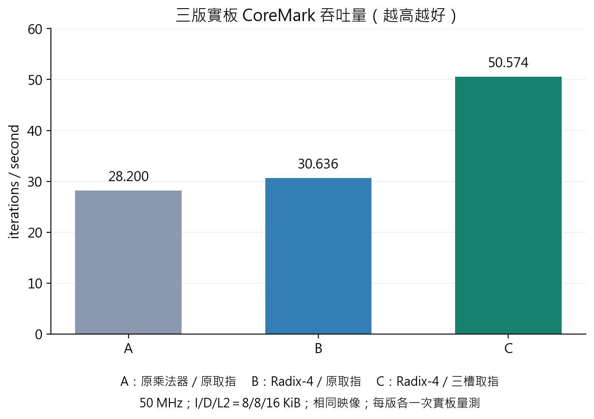
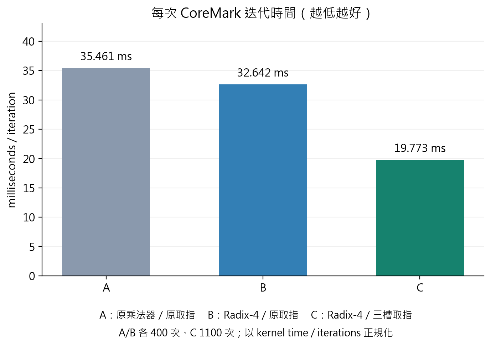
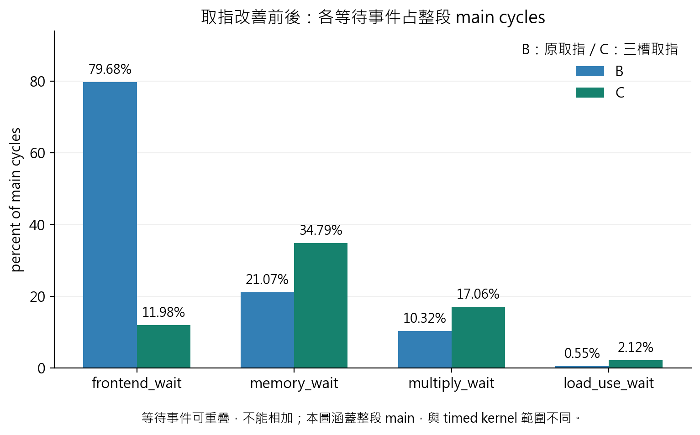

# 專題成果分析、結論與報告素材

整理日期：2026-10-29。本階段硬體開發到此收尾，後續以現有版本準備書面報告與簡報。
本文件整理既有證據；不新增 CPU、cache 或乘法器改良。

建議題目：**具效能監測與三槽取指機制之 FPGA RISC-V 處理器設計**。

## 一、專題主張

本專題完成可執行 bare-metal 程式的 FPGA RV32IM 處理器系統，建立以指令退休為基礎的
main 全程效能監測、UART 報告與 benchmark 驗證流程，並透過量測找出乘法等待及取指交接間隔，
分階段改善硬體。研究重點包含系統整合、量測定義、瓶頸分析、正確性驗證與實板效能比較。

報告可用下列流程串起主線：



## 二、完成範圍

### 處理器系統

- 以 Nexys A7-100T／Artix-7 為平台，整合 RV32IM 五階段 IF/ID/EX/MEM/WB pipeline。
- 包含 forwarding、hazard detection、branch prediction／redirect、乘除法。
- 實板比較使用 50 MHz、I-cache 8 KiB、D-cache 8 KiB、Unified L2 16 KiB、DDR2 MIG。
- 軟體由 RISC-V GCC 產生 ELF/BIN/MEM，再透過 UART bootloader 載入執行。
- 本次效能實驗使用 `board_top` 與終端機，不依賴 VGA。
- 聚焦裸機程式；未建立完整 CSR／trap／interrupt／OS 執行環境。

### 量測與驗證工具

- 15 個 64-bit 計數器：cycles、退休指令、cache lookup/miss、分支與各種等待事件。
- main 的外層呼叫退休後開始計數；納入 main 本體與子函式，包含外層 return 退休當拍。
- 「指令完成」以退休事件計算，包含沒有寫入暫存器的 store、branch 等指令。
- main 返回後凍結 snapshot，再傳送專用 UART 效能報告；報告傳送不會繼續改動快照。
- 區分整段 main PMU 計時與 CoreMark 自己的 timed kernel；後者用於 benchmark 速度比較。
- 保存原始 UART、JSON、CSV、firmware SHA256、版本與建置條件，便於重現。

### 硬體改良

1. 乘法器由原先 32 輪實作改為 17 輪 radix-4 Booth，保留 RV32M 指令功能。
2. 將原先單筆取指擴充為三個有序結果槽位，允許回應與新請求同拍交接。
3. 同 line miss 共用回填紀錄；不同 line 的查詢可在較早 miss 等待下層期間繼續進行。
4. L2 增加獨立唯讀 hit probe，使 A 等 DDR2、B 命中 L2、C 命中 I-cache 的結果可分別先準備，
   最後仍依 A/B/C 順序交給 CPU。
5. 補齊密集取指下的 WB→ID 旁路、EX 操作數保存，以及 EX 停等時的 load-use bubble 條件。

CPU 維持原本五階段架構。取指結果能提前完成、有序交付，不應稱為亂序執行 CPU。
主 DDR2 回填仍一次一條 line；L2 hit probe 不是完整的多筆 DDR2 outstanding 架構。

## 三、量測如何導向修改

### 發現一：等待事件名稱不等於單一硬體原因

原始實板 frontend_wait 約占 main cycles 的 81%，但它的定義是前端沒有有效 ID 指令、
且存在待交付／被阻擋取指。因此它可能同時包含取指管線交接、後端反壓、miss 與 redirect。

TB 分類觀測器在新乘法器、原取指、固定 3 iterations 的 performance 核心函式區間，
把 frontend_wait 分成約 50.25% hit lookup／交接、40.16% 後端反壓、9.50% redirect 關聯與 0.09% miss。
這些比例的分母是該 TB 區間的 frontend_wait，並非實板 main 全部 cycles；
分類也依優先順序分派，不能直接視為每項可移除的純 penalty。

來源：[FRONTEND_PROFILE_RESULTS.md](FRONTEND_PROFILE_RESULTS.md)。

### 發現二：命中率高，仍可能被交接吞吐限制

原始取指在沒有 miss、redirect 與後端 stall 的乾淨情境，下一個 request 的間隔仍為四拍。
這是 request initiation interval，不能寫成「每次 I-cache hit 的資料讀取延遲固定四拍」。

三槽設計讓請求、查詢、結果保存及 CPU 交付分離。
定向 TB 證實全命中、CPU 持續接收時，啟動延遲後可連續每拍交付一條指令。
這是理想前端吞吐，不等於整顆 CPU 的 IPC 變成 1；目前實板 main IPC 約為 0.293。

### 發現三：改善需要同時驗證取消與相依處理

增加在途請求後，必須處理槽位全滿、同拍 pop/push、同 line 合併、結果提前完成但仍依序交付、
redirect 後的舊回填晚到、錯誤 burst 排空與相鄰指令依賴。
這些情境是設計正確性的核心，不能僅憑 benchmark 回傳 0 就宣告完成。

## 四、三版實板比較

下表使用官方 CoreMark performance seed，三版映像 SHA256 完全相同。
頻率、cache 容量與 compiler 配置固定，速度採 timed kernel／iterations 正規化。

| 指標 | A：原乘法器＋原取指 | B：Radix-4＋原取指 | C：Radix-4＋三槽取指 |
|---|---:|---:|---:|
| timed iterations | 400 | 400 | 1100 |
| 每次迭代時間 | 35.461 ms | 32.642 ms | **19.773 ms** |
| iterations/s | 28.200340 | 30.635601 | **50.573680** |
| iterations/s/MHz | 0.564007 | 0.612712 | **1.011474** |
| 整段 main CPI | 6.112847 | 5.628888 | **3.412463** |
| frontend_wait／main cycles | 81.289% | 79.680% | **11.978%** |

| 比較 | 吞吐量增加 | 每次迭代時間減少 |
|---|---:|---:|
| A→B：乘法器階段 | 8.64% | 7.95% |
| B→C：取指階段 | 65.08% | 39.42% |
| A→C：累計結果 | **79.34%（1.793 倍）** | **44.24%** |

兩階段百分比不能直接相加；累計結果由 A/C 的實測每迭代時間計算。
每組也另有官方 validation seed 的 CRC 驗證；取指階段 validation 的時間減少為 39.33%，與 performance 接近。
performance／validation 不平均成一個新分數。





1100 與 400 次是官方自動校準的結果。迭代數不同時，不能直接比較 kernel 總秒數、
main cycles 或退休指令總數；main 另含校準試跑、初始化、驗證與 benchmark 內輸出。

## 五、目前瓶頸的結論

取指階段 performance main 的 frontend_wait 比例從 79.68% 降到 11.98%，
同時每次 kernel 迭代時間下降 39.42%。這支持取指交接與在途請求管理是有效的改善方向。

目前 memory_wait 約占 main cycles 的 34.79%，multiply_wait 約占 17.06%。
每千條退休指令的 memory_wait 約為 1186.0→1187.0、multiply_wait 約為 580.8→582.0，
顯示其占比提高主要與前端等待減少後的分母改變一致，不能解讀成資料存取或乘法器突然變慢。



收尾時可下的判斷：

- 已由實板確認整體 CoreMark 效能改善，且幅度與短程 TB 接近。
- 前端等待顯著下降，後端資料存取、乘法與相依停等更值得後續研究。
- 現有資料不足以把 memory_wait 全部歸因於 DDR2，或宣稱增加 D-cache 容量一定有效。
- 無法把取指階段的 65.08% 吞吐提升再分配給同拍交接、三槽、L2 probe 各自多少。
- I-cache miss／lookup 增加可能包含額外推測取指與回填交互作用；尚未逐項定因。

等待事件會重疊，不能畫成總和為 100% 的堆疊圖或直接套用互斥時間的加總推論。
這一階段不再新增改良，將上述後續問題列為未來工作。

## 六、驗證與證據

| 層級 | 已完成的檢查 | 主要用途 |
|---|---|---|
| 定向 cache／L2 TB | 八個延遲種子；三槽排序、同拍收送、hit-under-miss、同 line 合併、錯誤與 redirect | 檢查機制與邊界 |
| CPU 全系統回歸 | 十個程式 × 三組延遲配置，共 30 次；逐條比對 794,850 條 main 退休指令 | 獨立 RV32IM oracle 核對 PC 與暫存器寫入 |
| PMU／UART | main 起訖、退休計數、snapshot 凍結、實際 TX pin 解碼 | 確認量測與報告可靠 |
| CoreMark RTL | OFF/ON × performance/validation × deterministic/random，共八次 CRC PASS | 標準程式功能與短程 A/B |
| 合成 | CPU+L1 與 L2 的 OFF/ON，共四組 Vivado 2020.2 OOC synthesis | 可綜合性與資源／估計 timing |
| FPGA | A/B/C 各 performance、validation，CRC PASS，正式 kernel 均至少十秒 | 實際系統的受控比較 |

CRC 與回歸通過支持已測範圍的功能正確性，不等於完整 ISA 認證、形式驗證或所有程式皆已覆蓋。
四組 OOC synthesis 也不代替最終整板 routed timing／utilization 報表。

## 七、限制與未來工作

1. CoreMark 是主要效能工作負載，不能由單一 benchmark 推論所有應用都有 79.34% 提升。
2. 每版每組目前各一次實板捕獲，尚未量測跨次變異；有圖表時不虛構 error bar。
3. PMU main 範圍與 timed kernel 不同，等待比例不能直接說成官方 kernel 的精確分布。
4. 三槽前端會增加查詢與資源成本，尚未量測功耗或能效。
5. 三槽、L2 probe 與必要相依處理在同一階段整合，未做各機制獨立開關的消融實驗。
6. 未來可拆分 MEM hit／miss／writeback／仲裁等待，研究 load-use、乘法器與分支恢復。
7. 未來可加入 Embench 或較大的工作集；完整多筆 DDR outstanding、OS 支援不列為本階段完成項目。

上述項目屬於研究邊界與延伸方向，不是本階段仍在執行的硬體修改任務。

## 八、可直接放入報告的結論草稿

本專題完成具效能監測能力的 FPGA RV32IM 處理器系統，整合五階段流水線、多層快取、DDR2 與 UART，
並建立由裸機程式編譯、載入、執行至效能報告輸出的流程。透過以指令退休為基礎的計數器與
CoreMark 測試，辨識乘法運算等待及命中取指仍存在固定交接間隔的問題，進而採用 radix-4 Booth 乘法器、
三槽位取指、同拍請求／回應交接與 I-cache／L2 hit-under-miss 機制。
在相同 50 MHz、cache 容量與 benchmark 映像條件下，實板 performance seed 吞吐量由
28.200 提升至 50.574 iterations/s，每次迭代時間由 35.461 ms 降至 19.773 ms，
累計吞吐提升 79.34%、時間減少 44.24%。取指改良階段的 frontend_wait 占 main cycles 比例亦由
79.68% 降至 11.98%，且官方 CRC 與定向及系統回歸測試均通過。
結果顯示，透過明確的量測定義、瓶頸分析與受控實驗，可以有效改善處理器效能；
後續研究可針對資料存取停等、乘法器、分支恢復與更多工作負載進一步評估。

## 九、報告與簡報安排

書面報告建議八章：緒論、系統架構、效能量測方法、瓶頸分析、硬體改良、驗證方法、實驗結果、結論與未來工作。
核心章節應回答「原本哪裡慢、用什麼證據判斷、修改什麼、如何確認正確、改善多少、代價與限制為何」。

| 簡報頁次 | 主題 | 建議素材 |
|---|---|---|
| 1 | 題目與目標 | 專題主張與實板照片 |
| 2 | 系統架構與軟體流程 | pipeline/cache/DDR2/UART 方塊圖與 C→MEM→UART |
| 3 | 量測定義 | main 起訖、退休事件、UART snapshot |
| 4 | 原始瓶頸 | frontend_wait、TB 分類與四拍 request 間隔 |
| 5 | 乘法器改良 | 原 32 輪→radix-4 17 輪；A/B 數據 |
| 6 | 三槽取指設計 | 同 line 合併、A/B/C 提前完成且依序交付 |
| 7 | 正確性驗證 | 定向 TB、獨立指令 oracle、CRC、redirect／反壓 |
| 8 | 實板結果 | 三版吞吐與每迭代時間圖 |
| 9 | 代價與限制 | OOC 資源表、等待事件重疊、單一 benchmark／單次量測 |
| 10 | 結論與未來工作 | 1.793 倍吞吐、前端等待下降、後端研究方向 |

報告整理時另外保存最終 bitstream、Vivado routed timing／utilization、板卡照片與操作截圖；
目前 repo 的報告不能代替使用者 Vivado 工程內的最終實作報表。
書面格式、頁數及口頭報告長度尚未指定，本草稿先維持可轉換的 Markdown 與圖表格式。

## 十、資料索引與圖表重建

- [平台架構](PROJECT_OVERVIEW.md)、[PMU 定義](PERFORMANCE_MONITOR.md)。
- [原取指 TB 分析](FRONTEND_PROFILE_RESULTS.md)。
- [新舊乘法器實板比較](COREMARK_BOARD_BASELINE.md)。
- [三槽設計](FETCH_THREE_SLOTS.md)、[三槽 RTL 驗證](FETCH_THREE_SLOTS_RESULTS.md)。
- [三槽實板比較](COREMARK_BOARD_FETCH_THREE_SLOTS.md)。
- [原始三版捕獲](../benchmarks/results/coremark_board_20261028/)、[取指 OFF/ON 捕獲](../benchmarks/results/coremark_board_fetch_three_slots_20261029/)。
- [報告資料 summary.json](report_assets/summary.json)。
- 圖表各有 PNG 與 SVG：`coremark_throughput`、`coremark_iteration_time`、`wait_events`。

```powershell
python tools/build_project_report_assets.py
```

繪圖從已封存 JSON 讀值，檢查映像與平台相同，不操作板子，也不更動 RTL。
